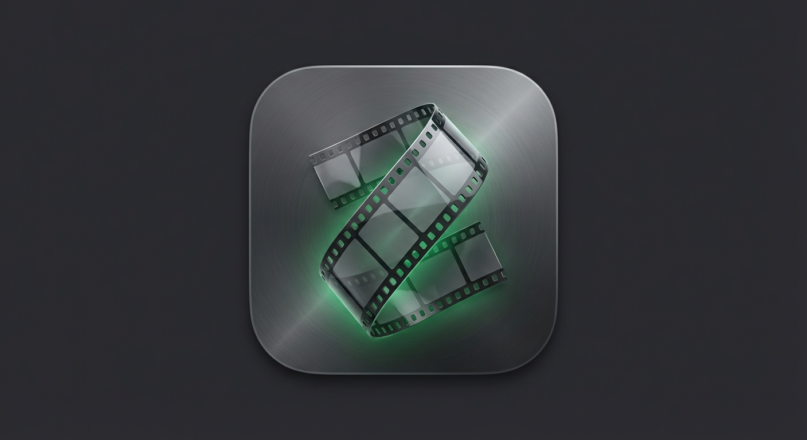

# MP4 Generator

A small macOS desktop app (PyQt5 + FFmpeg) that turns downloaded HLS/DASH video segments into a single playable MP4. Enter a Video ID, click a button, and the app does the FFmpeg work for you. No command line needed.



## Features

- **Transcode the video**: auto-detects the stream type from the files in the video folder, then splits audio and video, re-encodes them (AAC / H.264 at 30 fps), and muxes them into `<VideoID>.mp4`.
  - `v3v7`: HLS stream, `<VideoID>.m3u8`
  - `v5`: DASH stream, `<VideoID>-manifest.mpd`
- **Generate Playlist and Transcode**: for folders of raw `.ts` segments with no manifest. It builds a concat playlist from the sorted `.ts` files and copies them into one MP4 without re-encoding.
- **Play Audio only / Play Video only / Play the MP4**: preview the intermediate and final files with the bundled `ffplay`.
- **Show audio/video details**: runs `ffprobe` and shows audio, video and total durations.
- **Open File Location**: reveals the output folder in Finder.
- Live, color-coded FFmpeg output (errors in red, success in green, probe info in orange).

## Folder layout

The app reads and writes inside your Downloads folder:

```
~/Downloads/<VideoID>/raw/
├── <VideoID>.m3u8            # HLS manifest (v3v7), or
├── <VideoID>-manifest.mpd    # DASH manifest (v5)
├── *.ts / *.webm ...         # downloaded segments
├── audio-only.ts             # generated
├── video-only.ts             # generated
└── <VideoID>.mp4             # final output
```

## Install (macOS, Apple Silicon)

1. Download **`MP4-Generator.dmg`** (from the repo or the Releases page).
2. Open the DMG and drag **MP4 Generator** into **Applications**.
3. The first time, right-click the app and choose **Open** (the app is ad-hoc signed, not notarized). If macOS still blocks it, run:
   ```bash
   xattr -cr "/Applications/MP4 Generator.app"
   ```

FFmpeg, FFprobe and FFplay are bundled in the app, so you don't need to install anything else.

> The DMG is built for **Apple Silicon (arm64)** only.

## Run from source

Requires Python 3.9+ and FFmpeg on your `PATH` (`brew install ffmpeg`).

```bash
pip3 install PyQt5
python3 mp4-generator.py
```

`mp4-generator.sh` does the same in one step.

## Build the DMG yourself

On an Apple Silicon Mac with Homebrew FFmpeg (`brew install ffmpeg`):

```bash
pip3 install pyinstaller pillow PyQt5
python3 build_dmg.py
```

The script generates the app icon, builds the `.app` with PyInstaller, bundles FFmpeg and its dylibs, ad-hoc signs everything, and creates the DMG in `dist/`.

## Tests

```bash
QT_QPA_PLATFORM=offscreen python3 -m unittest test_mp4_generator -v
```

## Project files

| File | Purpose |
| --- | --- |
| `mp4-generator.py` | The application |
| `build_dmg.py` | Builds the `.app` and the DMG installer |
| `test_mp4_generator.py` | Unit tests for command building and resource paths |
| `mp4-generator.png` | App icon / screenshot |
| `install.sh`, `mp4-generator.sh` | Helpers for running from source |

## Author

Created by Sam.
